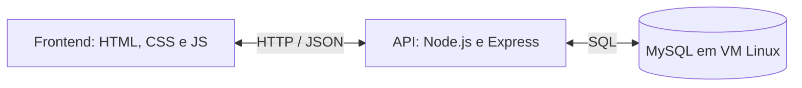

<div align="center">

# CUSCUZ ESPORTS | cZ

**Da comunidade ao competitivo: tecnologia aplicada ao PUBG Mobile.**


[Sobre](#sobre-o-projeto) • [Funcionalidades](#funcionalidades-previstas) • [Regras](#regras-de-negócio) • [Arquitetura](#arquitetura) • [Instalação](#como-executar) • [Roadmap](#roadmap)

</div>

---

## Sobre o projeto

O **Cuscuz Esports (cZ)** é uma aplicação web voltada à apresentação da comunidade e ao registro, organização e consulta dos resultados de seus campeonatos internos de **PUBG Mobile**, desenvolvida como Projeto Individual do primeiro semestre de Análise e Desenvolvimento de Sistemas da São Paulo Tech School (SPTech).

Minha relação com o PUBG Mobile começou há oito anos. O que inicialmente era entretenimento tornou-se parte da minha trajetória, proporcionando amizades em diferentes regiões do Brasil e experiências de liderança e organização de comunidades. Após a união do The Dragons com o Cuscuz Clã, participei da reformulação da identidade do grupo, propondo o nome Cuscuz Esports e contribuindo para seu posicionamento competitivo.

Atualmente, parte da apuração dos campeonatos é realizada manualmente. A proposta deste projeto é centralizar os registros, automatizar o cálculo das pontuações e preservar o histórico competitivo da comunidade, conectando minha experiência pessoal aos conhecimentos adquiridos na graduação.

## Funcionalidades previstas

| Módulo | Funcionalidades | Acesso |
| --- | --- | --- |
| Home | História, identidade visual e trajetória competitiva | Público |
| Dashboard | Classificação, PA, PP, PT, WWCD, pódio, quantidade de SLOTS, gráficos e MVP por campeonato | Público |
| Histórico competitivo | Consulta aos resultados de edições anteriores | Público |
| Autenticação | Login e cadastro de novos administradores por administradores autenticados | Restrito para cadastro |
| Gerenciamento | Cadastro, consulta, atualização e exclusão de dados de campeonatos, jogadores, SLOTS, partidas e resultados | Administrativo |
| Apuração | Registro de colocações e abates individuais, cálculo de pontos e classificação | Administrativo |

Os campeonatos poderão ser organizados nas modalidades **Solo, Duo e Squad**. Os visitantes não precisarão criar uma conta para consultar os resultados.

## Regras de negócio

### Pontuação

| Sigla | Significado |
| --- | --- |
| PA | Pontos por Abate: calculados a partir dos abates individuais dos integrantes do SLOT |
| PP | Pontos por Posição: definidos pela tabela de pontuação de cada campeonato |
| PT | Pontuação Total |
| WWCD | Winner Winner Chicken Dinner: vitória em uma partida |
| MVP | Most Valuable Player: jogador com maior quantidade acumulada de abates |

```text
Partida convencional:  PT = PA + PP
Partida com PA dobrado: PT = (PA × 2) + PP
```

O peso dobrado é configurado por partida e não altera a quantidade real de abates do jogador. A classificação considera a soma das pontuações de todas as partidas da edição.

### Classificação e desempate

Os SLOTS são classificados por PT em ordem decrescente. Em caso de empate, aplica-se a seguinte ordem:

1. Maior quantidade de vitórias (WWCD).
2. Maior quantidade de eliminações.
3. Melhor colocação na partida mais recente do campeonato.

Persistindo o empate, os SLOTS compartilham a mesma posição.

### MVP

O MVP é identificado pela soma dos abates reais de cada jogador no campeonato, sem multiplicar os abates das partidas com PA dobrado. Em caso de empate, considera-se o PP acumulado pelo SLOT de cada jogador. Persistindo o empate, os jogadores são reconhecidos como co-MVPs.

### SLOTS e participações

- Os SLOTS são formações específicas de cada campeonato, não equipes permanentes.
- A numeração competitiva começa no SLOT 2.
- Cada jogador pode integrar apenas um SLOT por campeonato.
- Os abates são registrados individualmente por partida, considerando somente os jogadores que efetivamente participaram.

## Tecnologias

| Camada | Tecnologias |
| --- | --- |
| Frontend | HTML, CSS e JavaScript |
| Backend | Node.js e Express, com base na API Web-Data-Viz |
| Visualização de dados | Chart.js |
| Banco de dados | MySQL e SQL |
| Infraestrutura | Máquina Virtual Linux |
| Desenvolvimento e governança | VS Code, Git, GitHub e Trello |

## Arquitetura

A aplicação segue a arquitetura cliente-servidor da Web-Data-Viz. O frontend envia requisições à API, que processa os dados e realiza operações no banco MySQL hospedado na Máquina Virtual Linux.



### Organização da base de código

| Arquivo ou diretório | Responsabilidade |
| --- | --- |
| `public/` | Interfaces, estilos, scripts e recursos visuais |
| `src/routes/` | Rotas da API |
| `src/controllers/` | Recebimento e processamento das requisições |
| `src/models/` | Operações e consultas ao banco de dados |
| `src/database/` | Configuração da comunicação com o banco |
| `app.js` | Inicialização e configuração da aplicação |
| `package.json` | Dependências e comandos do projeto |

A estrutura acima representa a organização esperada a partir da base Web-Data-Viz e poderá ser detalhada conforme a evolução do repositório.

## Banco de dados

A modelagem relacional utiliza o banco `cuscuz_esports`, composto por nove tabelas:

| Tabela | Responsabilidade |
| --- | --- |
| `usuario` | Contas administrativas e credenciais |
| `campeonato` | Edições, datas e modalidades |
| `jogador` | Cadastro dos jogadores da comunidade |
| `slot_campeonato` | SLOTS de cada edição |
| `slot_jogador` | Associação entre jogadores e SLOTS |
| `pontuacao_posicao` | Pontos por colocação de cada campeonato |
| `partida` | Quedas, mapas, datas e configuração de PA dobrado |
| `resultado_slot_partida` | Colocação de cada SLOT por partida |
| `participacao_jogador` | Participação efetiva e quantidade individual de abates |

A modelagem utiliza chaves primárias, chaves estrangeiras (inclusive compostas), restrições de unicidade e validações de valores para preservar a integridade dos registros. As pontuações são derivadas dos resultados e das participações registradas.

## Identidade visual

| Cor | Hexadecimal | Aplicação |
| --- | --- | --- |
|  | `#FF7B01` | Destaques e identidade da marca |
|  | `#000000` | Base visual e contraste |
|  | `#FFFFFF` | Textos e contraste |

**Tipografia de referência:** Horta / New Sun Playful (títulos), Montserrat (subtítulos) e Poppins / Glacial Indifferent (corpo).

## Como executar

> As instruções abaixo são preliminares e serão validadas durante a integração da aplicação.

### Pré-requisitos

- Git e Node.js com npm instalados.
- Máquina Virtual Linux com MySQL ativo e acessível pela máquina que executa a API.
- Script SQL da modelagem do Cuscuz Esports.

### 1. Clonar o repositório

Copie a URL em **Code** no GitHub e execute os comandos, substituindo os valores entre sinais de menor e maior pelos dados do repositório:

```bash
git clone <URL_DO_REPOSITORIO>
cd <PASTA_DO_REPOSITORIO>
```

Execute os próximos comandos na pasta que contém o `package.json`.

### 2. Instalar as dependências

```bash
npm install
```

### 3. Configurar o banco de dados

Execute o script SQL de criação do banco `cuscuz_esports` no MySQL da VM Linux. Configure um usuário com as permissões necessárias e verifique a conectividade entre a máquina local e a VM.

### 4. Configurar as variáveis de ambiente

Configure o arquivo `.env.dev` conforme as variáveis esperadas pela base Web-Data-Viz. Exemplo a conferir com a configuração do projeto:

```dotenv
DB_HOST=IP_DA_VM
DB_DATABASE=cuscuz_esports
DB_USER=USUARIO_DO_BANCO
DB_PASSWORD=SENHA_DO_BANCO
DB_PORT=3306
APP_PORT=3333
APP_HOST=localhost
```

Não publique credenciais reais no GitHub. Verifique se os arquivos de ambiente com segredos estão no `.gitignore`.

O procedimento de criação da primeira conta administrativa deverá ser documentado após a implementação da autenticação.

### 5. Iniciar a aplicação

```bash
npm start
```

Se a porta padrão da base for mantida, acesse `http://localhost:3333` no navegador.

## Roadmap

- [x] Definição do tema e documentação inicial
- [x] Modelagem do banco de dados e elaboração do script DDL
- [x] Primeiro commit com a base Web-Data-Viz
- [ ] Configuração e validação da VM Linux e do MySQL
- [ ] Adaptação da API ao Cuscuz Esports
- [ ] Desenvolvimento da Home
- [ ] Cadastro, login e controle de acesso administrativo
- [ ] Gerenciamento de campeonatos, jogadores, SLOTS e partidas
- [ ] Registro de resultados e abates
- [ ] Cálculo de pontuações, classificação e MVP
- [ ] Dashboard e consulta ao histórico competitivo
- [ ] Integração e testes
- [ ] Documentação final, Diário de Prompts e apresentação

O checklist acompanha o desenvolvimento da aplicação e será atualizado ao longo dos commits.

## Limites do projeto

Esta versão acadêmica é destinada exclusivamente ao Cuscuz Esports. Não contempla aplicativo nativo, pagamentos, chat, transmissão ao vivo, OCR, integração direta com a API do PUBG Mobile ou perfis e rankings individuais de jogadores. Os abates individuais são utilizados para calcular o desempenho coletivo e identificar o MVP.

## Contexto acadêmico e créditos

- **Instituição:** São Paulo Tech School (SPTech)
- **Curso:** Análise e Desenvolvimento de Sistemas
- **Turma:** 1ADSB — 2026.2
- **Projeto:** Projeto Individual
- **Prazo previsto:** 26/11/2026

A estrutura inicial da aplicação utiliza a **Web-Data-Viz**, disponibilizada pelos professores da SPTech como material de apoio. O desenvolvimento das funcionalidades específicas do Cuscuz Esports será realizado a partir dessa base, respeitando a arquitetura e as orientações acadêmicas.

Ferramentas de inteligência artificial são utilizadas como apoio ao aprendizado, à revisão e ao desenvolvimento, com registro no Diário de Prompts.

## Autoria

**Larissa Queiroz da Silva** — estudante de Análise e Desenvolvimento de Sistemas e integrante da liderança do Cuscuz Esports.

Comunidade: [@cuscuzesports](https://www.instagram.com/cuscuzesports/)

---

<div align="center">

**CUSCUZ ESPORTS — cZ** 🧡

Projeto acadêmico • SPTech • 2026

</div>
